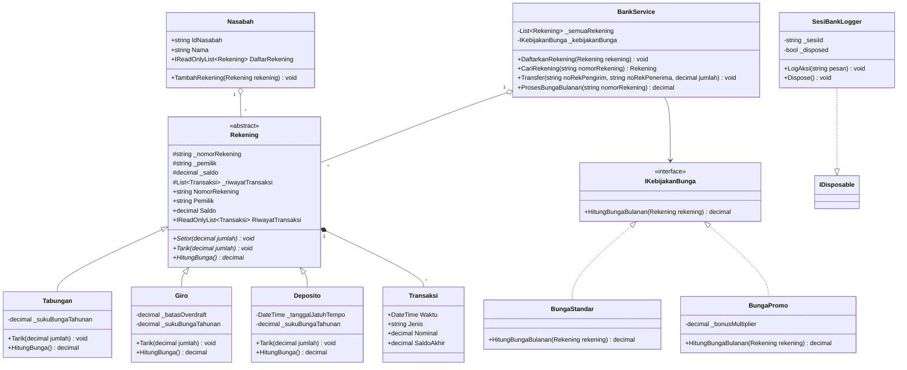

# Proyek ETS PBO

> Baca `SOAL.md` dulu. Ganti semua `TULIS_DI_SINI` di berkas ini, `AI-LOG.md`, dan `PROSES.md`. Berkas yang masih berisi
> `TULIS_DI_SINI` dianggap belum diisi.

## Identitas

- Nama: Najwan Sigit Cahya Buana
- NRP: 5025251031
- Domain: 3

## Domain saya


Aplikasi ini ditujukan untuk Teller / Operator bank dan juga Nasabah bank. Beberapa masalah yang diselesaikan aplikasi ini adalah mempermudah proses pengelolaan rekening yang memiliki aturan yang berbeda dan proses kalkulasi lainnya. Aplikasi ini juga menggunakan prinsip All or Nothing untuk memastikan proses transfer nasabah dapat berjalan lancar. 

## Cara menjalankan

```bash
dotnet build proyek/src
dotnet run --project proyek/src
```

## Diagram kelas



## Status kebutuhan


| ID | Kebutuhan | Status | Catatan |
|---|---|---|---|
| K1 | Enkapsulasi | Selesai | Atribut internal disimpan dengan private / protected dan data penting disimpan di IReadOnlyList|
| K2 | Komposisi dan pewarisan | Selesai |Subkelas Tabungan, Giro, dan Deposito mewarisi kelas induk Rekening, serta Nasabah mengimplementasikan komposisi melalui daftar Rekening. |
| K3 | Polimorfisme | Selesai |Penerapan override pada method Tarik(), HitungBunga(), dan ToString() sesuai karakteristik tiap subkelas. |
| K4 | Abstract class dan interface | Selesai |Kelas Rekening sebagai abstract class, serta IKebijakanBunga sebagai interface. |
| K5 | Exception dan life cycle | Selesai |Custom exception (SaldoTidakCukupException, RekeningTidakDitemukanException) serta manajemen resource via IDisposable (SesiBankLogger). |
| K6 | Aplikasi berjalan | Selesai |Program dapat dikompilasi dan berjalan lancar tanpa error saat mengeksekusi demo skenario di Program.cs. |
| Khas | Aturan khas domain | Selesai |Fitur Overdraft pada Giro, jangka waktu Deposito, dan mekanisme Transfer All-or-Nothing dengan rollback otomatis. |
| Bonus | Bonus yang dikerjakan | Sebagian |Membuat diagram kelas menggunakan mermaid, kemudian Strategy Pattern diterapkan untuk mengelola variasi kalkulasi bunga bulanan pada rekening nasabah. Hal ini membuat mengubah aturan suku bunga jadi dinamis tanpa mengubah logika inti.   |

## Yang belum selesai

- Unit Test xUnit
- Penyimpanan Data JSON
- Pengurutan & Kesetaraan (IComparable<'T'>/IEquatable<'T'>)